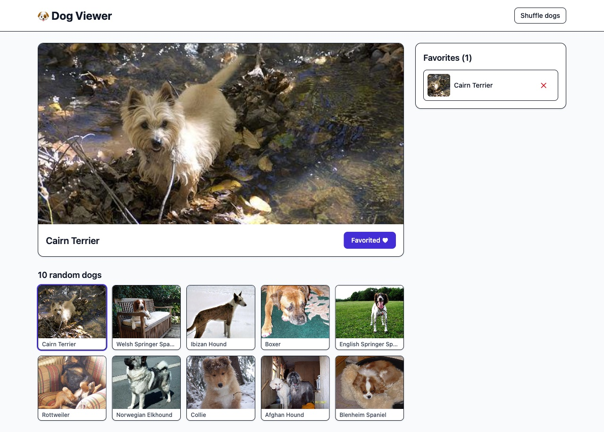

# 🐶 Dog Viewer

[](https://github.com/igorbabko/dog-viewer/actions/workflows/ci.yml)

A tiny single-page app that browses random dog images from the
[Dog API](https://dog.ceo/dog-api/documentation) and keeps a persistent
favorites list. React + TypeScript + Vite + Tailwind CSS v4.

Built as a one-hour coding exercise, then hardened: corrected breed labels,
race-free loading, a11y and performance passes, tests, and the spec/ADR docs to
extend it.



## Run it

```bash
npm ci
npm run dev      # http://localhost:5173
```

```bash
npm run build     # typecheck + production build -> dist/
npm run preview   # preview the build
npm run lint      # oxlint, warnings are errors
npm run typecheck # tsc -b, strict
npm test          # Vitest + React Testing Library (66 tests)
npm run coverage  # v8 coverage with thresholds (~97% statements, ~94% branches)
```

Requires Node 22+ (see `.nvmrc`) and internet access (Dog API).

## Features

**Part 1 — General display**
- Random main image on top, labelled by breed
- 10 random thumbnails, each with its breed; click one to promote it
- Smooth hover/focus zoom on thumbnails (disabled under `prefers-reduced-motion`)

**Part 2 — Favorites**
- Favorite control adds the main dog to a sidebar on the right, deduped by URL
- Favorites persist in `localStorage` and sync across tabs
- Click a favorite to promote it; remove it with the adjacent button

**Cross-cutting:** loading/error/retry, a Shuffle that always gives a matching
main image, responsive layout, keyboard support, and live-region announcements.

## Architecture

```
src/
  domain/dog.ts            DogImage type, parseBreed, runtime validation
  api/dogs.ts              Dog API transport: timeout, abort, shape checks
  hooks/useDogs.ts         Gallery/main-image state machine, race-free loading
  hooks/useFavorites.ts    Favorites, localStorage, cross-tab sync
  components/
    MainImage.tsx          Main image, breed label, favorite toggle
    GalleryGrid.tsx        Thumbnail grid
    FavoritesSidebar.tsx   Favorites list
  App.tsx                  Composition only
```

`domain` is pure vocabulary and logic. `api` is transport-only. Hooks own
stateful behaviour. Components are presentational. `App` wires them together.

## Decisions & tradeoffs

- **Breed from the URL.** The API path segment is not a consistent
  `<sub-breed>-<breed>`; `german-shepherd` must not become "Shepherd German".
  A tested display-name map fixes irregulars, with a heuristic fallback.
  See [ADR-0002](docs/adr/0002-dog-api-and-breed-labels.md).
- **No data library.** One screen, one source. A reducer-driven `useDogs` hook
  aborts stale requests, times out at 10s, and resets the main image so it is
  always part of the current gallery. See
  [ADR-0004](docs/adr/0004-data-loading-and-state-model.md).
- **localStorage favorites.** No backend; entries are validated (`https:` URLs,
  deduped, tamper-resistant). See
  [ADR-0003](docs/adr/0003-localstorage-favorites.md).
- **No memoisation.** At 10 thumbnails it would cost more than it saves.

## Accessibility

- Semantic landmarks (`header`, `main`, labelled `section`s, `aside`) and a
  single `h1`.
- Loading, breed changes, error, and favorites count are announced via live
  regions; the main image uses `aria-busy`.
- The favorite control is an `aria-pressed` toggle (keyboard focus is kept).
- Visible `focus-visible` styles; thumbnails zoom on focus as well as hover.
- `prefers-reduced-motion` disables the pulse and zoom transitions.

## Performance

- Main image (`LCP` candidate) uses `fetchPriority="high"` + `decoding="async"`.
- Thumbnails are `loading="lazy"` and `decoding="async"`.
- `preconnect` hints for `dog.ceo` and `images.dog.ceo` in `index.html`.
- Fixed image heights prevent layout shift.
- Known limit: the Dog API serves full-size images; thumbnails download the
  original. A resize proxy is in the [backlog](docs/backlog.md).

## Testing

- Pure logic and transport unit tests; hooks via `renderHook`; behaviour tests
  query by role/label.
- `App.test.tsx` covers the two spec parts, retry, failed shuffle with stale
  content, favorite selection during an API error, and a StrictMode render.
- Coverage thresholds are enforced in `vite.config.ts`; CI runs lint,
  typecheck, coverage, and build.

## Spec-driven development

- Spec with acceptance criteria: [`docs/specs/dog-viewer.md`](docs/specs/dog-viewer.md)
- Domain language: [`GLOSSARY.md`](GLOSSARY.md)
- Decisions: [`docs/adr/`](docs/adr/)
- Backlog / next steps: [`docs/backlog.md`](docs/backlog.md)
- Agent guidance: [`AGENTS.md`](AGENTS.md); issue tracker and triage docs under
  [`docs/agents/`](docs/agents/)

## Timebox notes

The original exercise was scoped to one hour (core display + favorites). The
hardening above was a deliberate second pass. Deliberately skipped for scope:
E2E tests, image-proxy thumbnails, routing, and any state/data library.
